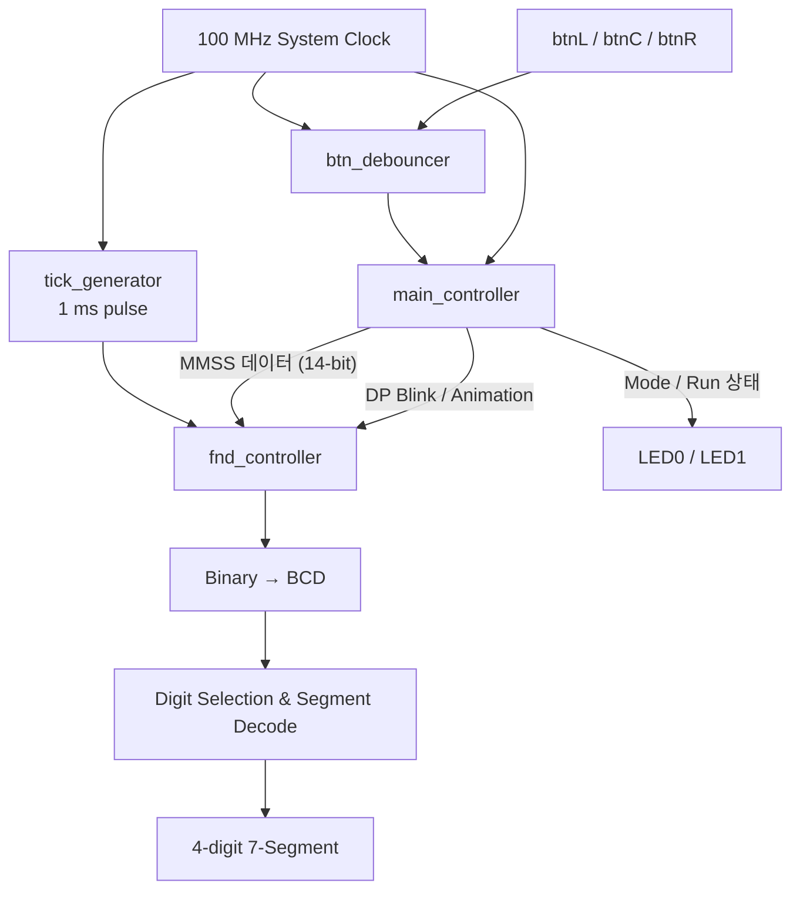

# Basys3 FPGA — 분·초 시계 & 스톱워치

**Verilog HDL · Digilent Basys3 · Xilinx Vivado 2021.2**

Basys3 FPGA 보드에서 **분·초 시계(Clock)**와 **스톱워치(Stopwatch)**를 전환해 사용하는 RTL 설계 프로젝트입니다. 100 MHz 시스템 클록을 기준으로 시간을 계산하고, 버튼 입력을 디바운싱하여 4자리 7-Segment Display(FND)에 `MM:SS` 형태로 표시합니다.

> 이 README는 저장소의 **실제 RTL, XDC, 테스트벤치**를 기준으로 작성했습니다. `refre/10.pwm_control/`은 별도의 PWM 참고 예제이며 시계/스톱워치의 메인 설계와 구분합니다.

## 1. 프로젝트 개요

| 항목 | 내용 |
| --- | --- |
| 개발 보드 | Digilent **Basys3** (Artix-7, `xc7a35tcpg236-1`) |
| 설계 언어 | Verilog HDL |
| 개발 환경 | Xilinx Vivado **2021.2** |
| 시스템 클록 | **100 MHz** (10 ns) |
| 입력 | 버튼 3개(btnL / btnC / btnR), SW15 리셋 |
| 출력 | 4자리 7-Segment Display, 상태 LED |
| 표시 범위 | **00:00 ~ 59:59** (분:초) |
| 테스트 자료 | `main_controller_tb.v` (기능 검증 시나리오) |

### 주요 기능

| 기능 | RTL 동작 |
| --- | --- |
| 시계 모드 | 리셋 후 기본 모드. 분·초가 1초마다 증가하며, 59:59 다음에 00:00으로 순환 |
| 스톱워치 모드 | btnL로 모드 전환. btnR로 실행/정지 토글 |
| 스톱워치 초기화 | btnC로 스톱워치의 분·초를 00:00으로 초기화 |
| 구분점 점멸 | 시계 모드에서 FND의 DP를 1초 간격으로 켜고 끔 |
| 정지 애니메이션 | 스톱워치가 정지된 상태로 **5초 동안 버튼 입력이 없으면** 7-Segment 외곽을 따라 순차 점등 |
| 상태 표시 | `led[0]`: 스톱워치 모드, `led[1]`: 스톱워치 실행 중 |
| 버튼 디바운싱 | 버튼별 약 10 ms 안정 구간을 검사하여 입력 잡음 완화 |

**참고:** 시계는 FPGA 내부 카운터 기반의 **경과 시간 표시**입니다. RTC로 실제 시각을 받아오는 기능은 없습니다. btnC는 *시계 카운터가 아니라 스톱워치 카운터*를 초기화합니다.

## 2. Basys3 버튼 및 I/O 연결

아래 핀은 저장소의 [Basys3 XDC 파일](refre/my_minsec_stopwatch.srcs/constrs_1/imports/digilent-xdc-master/Basys3-Master_orginal.xdc)을 기준으로 확인했습니다.

| 보드 조작 | FPGA 포트 | 패키지 핀 | 기능 |
| --- | --- | --- | --- |
| **btnL** | `btn[0]` | W19 | 시계 ↔ 스톱워치 모드 전환 |
| **btnC** | `btn[1]` | U18 | 스톱워치 시간 초기화 |
| **btnR** | `btn[2]` | T17 | 스톱워치 실행 ↔ 정지 |
| **SW15** | `reset` | R2 | Active-High 전체 리셋 |
| 100 MHz 클록 | `clk` | W5 | 10 ns 시스템 클록 |
| LED0 | `led[0]` | U16 | 스톱워치 모드 여부 |
| LED1 | `led[1]` | E19 | 스톱워치 실행 여부 |
| 7-Segment | `seg[7:0]`, `an[3:0]` | XDC 참조 | FND 세그먼트와 자리 선택 |

- 리셋 후에는 **시계 모드 / 00:00**부터 시작합니다.
- 스톱워치 모드로 처음 진입하면 내부 실행 플래그가 **ON**으로 초기화되어 있으므로, 처음에는 시간이 증가합니다.
- `sw[7:0]`는 최상위 포트와 XDC에 선언되어 있으나, 현재 메인 제어 로직에서는 사용되지 않습니다.

## 3. 시스템 블록 다이어그램



### 시간 및 표시 처리

1. **시간 카운트:** `main_controller`는 100 MHz 클록 **100,000,000회**를 기준으로 1초 조건을 생성합니다.
2. **분·초 증가:** 초가 59에 도달한 다음 틱에서 0으로 돌아가고 분을 증가시킵니다. 분도 59 다음에 0으로 돌아갑니다.
3. **표시 데이터:** `분 × 100 + 초`를 14-bit 값으로 구성해 FND 컨트롤러에 전달합니다.
4. **BCD 변환:** `bin2bcd4digit`가 숫자를 천/백/십/일 자리로 분리합니다.
5. **멀티플렉싱:** `tick_generator`가 1 ms 주기로 펄스를 내보내고 `fnd_digit_select`가 4개 자리를 순차 선택합니다.

```text
System Clock 100 MHz
    ├─ main_controller: 100,000,000 cycles → 1 second
    │    ├─ Clock MM:SS counter
    │    └─ Stopwatch MM:SS counter
    │
    └─ tick_generator: 100,000 cycles → 1 ms pulse
         └─ fnd_digit_select → an[3:0] → Segments / DP
```

### 정지 상태 애니메이션

스톱워치 모드에서 **정지 상태가 5초간 유지**되면 `animation_active`가 활성화됩니다. 이후 `animation_step` 0~11 값에 따라 7-Segment의 특정 위치를 순서대로 점등합니다. 버튼을 누르면 유휴 시간과 애니메이션 상태가 초기화됩니다.

## 4. RTL 모듈 구성

시계/스톱워치 프로젝트 소스 경로: [`refre/my_minsec_stopwatch.srcs/`](refre/my_minsec_stopwatch.srcs)

| 파일 | 역할 |
| --- | --- |
| [`top.v`](refre/my_minsec_stopwatch.srcs/sources_1/imports/sources_1/new/top.v) | 모듈 간 신호 연결 및 보드 I/O 연결 |
| [`main_controller.v`](refre/my_minsec_stopwatch.srcs/sources_1/imports/sources_1/new/main_controller.v) | 모드, 1초 카운터, 시계/스톱워치, 버튼 엣지, 애니메이션 제어 |
| [`btn_debounce.v`](refre/my_minsec_stopwatch.srcs/sources_1/imports/sources_1/imports/new/btn_debounce.v) | btnL/C/R 각각 디바운싱 |
| [`tick_generator.v`](refre/my_minsec_stopwatch.srcs/sources_1/imports/sources_1/new/tick_generator.v) | 100 MHz 입력에서 1 ms 펄스 생성 |
| [`fnd_controller.v`](refre/my_minsec_stopwatch.srcs/sources_1/imports/sources_1/new/fnd_controller.v) | FND 자리 선택, 4자리 BCD 변환, 숫자 디코딩, DP 및 애니메이션 출력 |
| [`main_controller_tb.v`](refre/my_minsec_stopwatch.srcs/sim_1/imports/new/main_controller_tb.v) | 시계/스톱워치 제어 로직 테스트벤치 |
| [`Basys3-Master_orginal.xdc`](refre/my_minsec_stopwatch.srcs/constrs_1/imports/digilent-xdc-master/Basys3-Master_orginal.xdc) | Basys3 핀맵 및 클록 제약 |

메인 Vivado 프로젝트: [`refre/my_minsec_stopwatch.xpr`](refre/my_minsec_stopwatch.xpr)

별도 참고용 RTL/PWM 학습 자료: [`refre/10.pwm_control/`](refre/10.pwm_control) (메인 시계/스톱워치와 별도)

## 5. 실행 및 시뮬레이션

### Vivado에서 열기

1. Vivado 2021.2에서 `refre/my_minsec_stopwatch.xpr` 파일을 엽니다.
2. **Design Sources**의 최상위 모듈이 `top`인지 확인합니다.
3. **Constraints**에 위 Basys3 XDC가 지정되어 있는지 확인합니다.
4. **Simulation Sources**에서 `main_controller_tb`를 선택한 후 **Run Behavioral Simulation**을 실행합니다.
5. 보드에서 동작시키려면 Synthesis / Implementation / Generate Bitstream 이후 Basys3에 프로그램합니다.

### Icarus Verilog로 컨트롤러 테스트

저장소 최상위 디렉터리에서 아래 명령을 실행합니다. Icarus Verilog의 `iverilog`, `vvp`가 PATH에 있어야 합니다.

```bash
iverilog -g2012 -s main_controller_tb -o stopwatch_tb.vvp \
  refre/my_minsec_stopwatch.srcs/sources_1/imports/sources_1/new/main_controller.v \
  refre/my_minsec_stopwatch.srcs/sim_1/imports/new/main_controller_tb.v

vvp stopwatch_tb.vvp
```

이 테스트벤치는 빠른 검증을 위해 `CLK_FREQ=10`, `IDLE_SECONDS=5`로 파라미터를 축소합니다.

**테스트벤치에 작성된 검증 항목:** 시계 증가/점멸, 모드 전환, 스톱워치 시간 증가, 정지 5초 후 애니메이션, 재실행, 초기화. 테스트 스크립트가 에러 없이 모든 조건을 만족하면 `PASS: timing chart checks completed with 0 errors.`를 출력하도록 작성되어 있습니다.

> 테스트 실행 성공 여부는 이 README 작성 과정에서 별도로 재검증하지 않았습니다. 저장소의 `refre/test.bat`는 현재 테스트벤치 실경로(`...srcs/sim_1/imports/new/main_controller_tb.v`)와 다른 `...sim/sim_1/new/` 경로를 참조하고 있으므로, 우선 위의 명령이나 Vivado 시뮬레이터를 사용하세요.

## 6. 설계 시 고려한 점과 개선 과제

- **버튼 노이즈 처리:** 100 MHz 기준 약 10 ms 동안 입력 변화가 유지될 때만 상태를 갱신하도록 디바운싱합니다.
- **동기식 엣지 검출:** 이전 버튼 상태 `r_prev_btn`과 현재 디바운싱 결과를 비교해 1회 누름 이벤트를 감지합니다.
- **시간 표시 분리:** 시간 카운터와 FND 숫자 디코더를 별도 모듈로 구성해 재사용성을 높였습니다.
- **개선 필요 — 파생 클록:** 현재 `fnd_digit_select`는 `posedge tick`을 사용합니다. 확장 설계에서는 단일 시스템 클록 + 1주기 `clock enable` 방식으로 정리하는 것이 권장됩니다.
- **개선 필요 — 타이밍/검증:** 버튼 입력 동기화, 전체 Top-Level 검증, 보드 실측 결과와 타이밍 리포트는 추가 확인이 필요합니다.
- **범위 구분:** FPGA 내부 카운터 기반 시계이며 외부 RTC·알람·통신 기능은 포함하지 않습니다.

## 7. 프로젝트에서 학습한 내용

- **Verilog RTL:** `wire` 신호 연결, `reg` 상태 저장, 순차/조합 논리의 역할
- **시간 제어:** 시스템 클록 분주, 1초 틱 생성, 분·초 자리 올림과 범위 처리
- **디지털 인터페이스:** 버튼 디바운싱, 상승 엣지 검출, FND 멀티플렉싱 및 Active-Low 출력
- **시뮬레이션:** 테스트벤치 파라미터 축소, 버튼 이벤트 및 시간 변화 검증
- **하드웨어 구현:** XDC 핀 제약과 Basys3의 버튼·LED·7-Segment 연결

---

**Repository:** [leesee1393-ux/my_minsec_stopwatch](https://github.com/leesee1393-ux/my_minsec_stopwatch)  
**Portfolio:** [leesee1393-ux.github.io](https://leesee1393-ux.github.io/)
